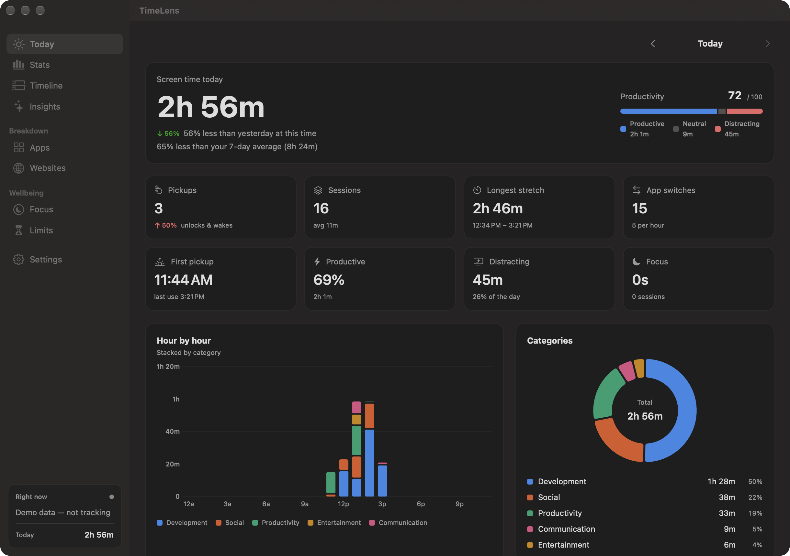
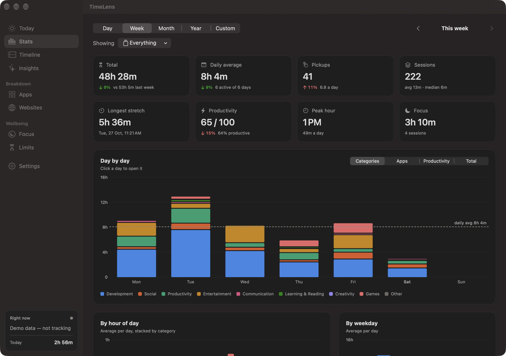
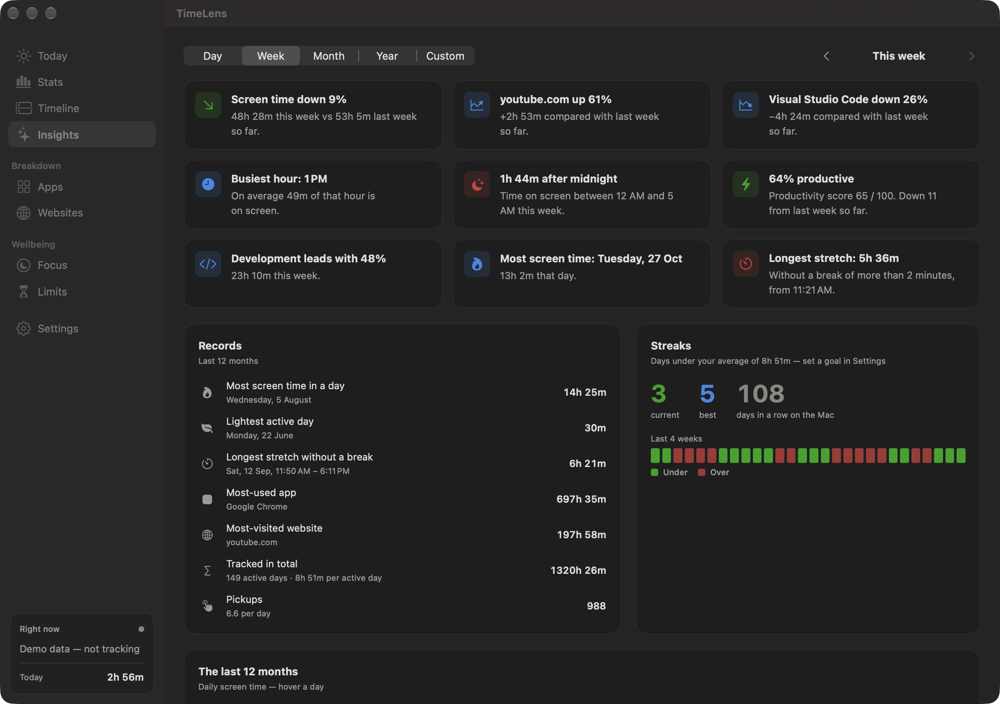

# TimeLens

A precise screen time tracker for macOS. It runs in the menu bar and counts time per app, per
website and per window, to the second. All data stays on your Mac.



## Download

Get the latest `.dmg` from **[Releases](../../releases/latest)**. Open it and drag TimeLens into
Applications. Requires **macOS 15 (Sequoia) or later**.

> **First launch:** TimeLens is ad-hoc signed, not notarized by Apple, so macOS will block it the
> first time. Right-click the app → **Open** → **Open**, or run:
>
> ```sh
> xattr -dr com.apple.quarantine /Applications/TimeLens.app
> ```

## Features

- **Per app, website and window.** Reads the current tab's URL in Chrome, Brave, Edge, Arc,
  Vivaldi, Opera, Safari and Firefox. Private/incognito tabs can be labelled, ignored or tracked.
- **Honest idle handling.** When you step away it takes back the idle tail, but it keeps counting
  while video or a call is playing.
- **Deep stats.** Screen time by app, site, category, hour, day, weekday and session, with
  pickups, longest stretch, a productivity score, heatmaps, a timeline and insights (records,
  streaks, the last 12 months).
- **Daily limits** per app, site or category, enforced with a full-screen shield.
- **Focus sessions**, **break reminders** and **daily/weekly summaries**.
- **Private.** Everything lives in a local SQLite file in
  `~/Library/Application Support/TimeLens`. Nothing is sent anywhere.

| Stats | Insights |
| --- | --- |
|  |  |

## Permissions

- **Accessibility:** window titles, plus Firefox's address bar.
- **Automation (per browser):** reads the current tab's URL in Chromium browsers and Safari.
- **Notifications:** limit warnings, break reminders and summaries.

The app is signed ad hoc, so macOS forgets these grants on every rebuild. Re-grant them in
System Settings → Privacy & Security after reinstalling.

## Build from source

Needs only the Command Line Tools (Swift 6), not Xcode.

```sh
Scripts/build-app.sh            # → build/TimeLens.app
Scripts/build-app.sh --install  # copy to /Applications and launch
Scripts/make-dmg.sh             # → build/TimeLens-<version>.dmg
Scripts/test.sh                 # unit tests (TimeLensCore)
```

## Project layout

```
Sources/TimeLensCore/   pure logic: URL → website, categories, the tracking state machine,
                        bucketing, stats and insights math (unit tested)
Sources/TimeLens/       the app: tracker, SQLite store, wellbeing (limits, shield, focus,
                        notifications), menu bar and SwiftUI dashboard
Tests/TimeLensTests/    Swift Testing suites for TimeLensCore
Scripts/                build, dmg, test and snapshot helpers
```

## Debug

- `TimeLens --demo-data` runs on 150 days of generated history, kept in a separate `demo.sqlite`.
- `Scripts/snapshot.sh <section> out.png [height] [app:<id>|site:<site>]` renders a dashboard
  page off screen from the demo data. `Scripts/snapshot.sh window out.png [section]` renders the
  whole dashboard window; it also saves an in-process render next to the window-id file, for
  hosts without Screen Recording access.

## License

[GPL-3.0](LICENSE) © Advait Desai
